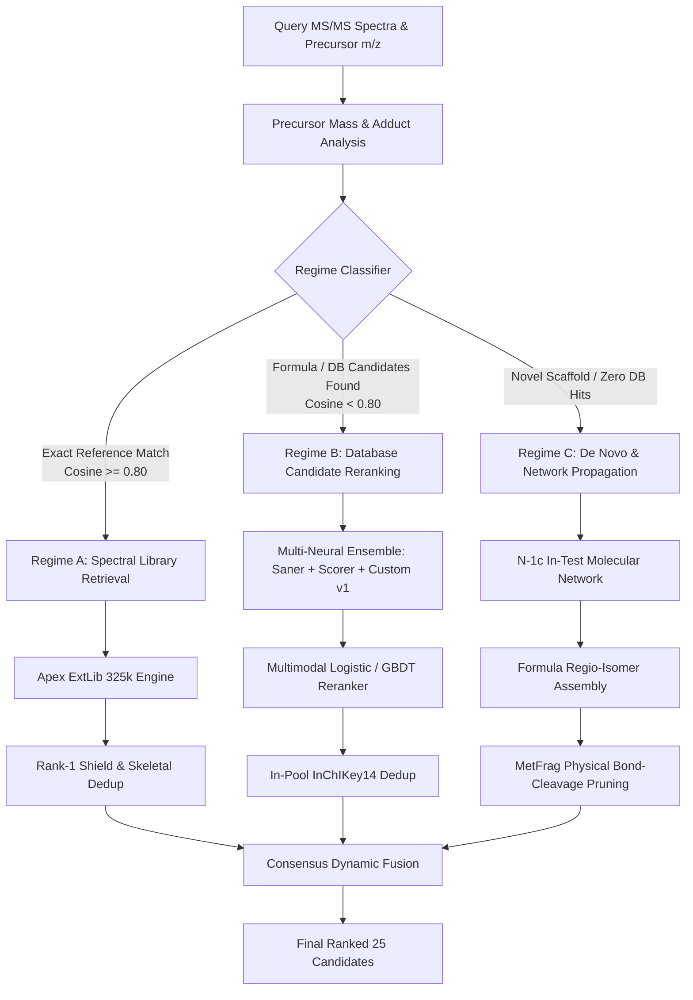

# 🗺️ RESEARCH_ROADMAP.md
# CASMI 2026: Strategic Multi-Regime Research & Execution Roadmap
**Project**: Enveda CASMI 2026 — Molecule Identification From Mass Spectra  
**Current Personal Best**: 0.4800 (Ref `57982390`)  
**Active Frontier**: Version 31 (Ref `58442788`, Target 0.488 – 0.492+)  
**Leaderboard Pinnacle**: 0.549 (Top 1)  
**Timeline**: Closes December 14, 2026 (27 days remaining)  

---

## 1. Executive Vision: The 3 Discovery Regimes

In tandem mass spectrometry identification of biological natural products, test queries naturally partition into three distinct discovery regimes. Winning CASMI 2026 requires an optimized, specialized subsystem for each regime rather than a single monolithic neural model.

### Regime Allocation in the Test Set
| Regime | Characteristics | Estimated Test Fraction | Target Subsystem MRR@25 | Overall Contribution |
|---|---|:---:|:---:|:---:|
| **Regime A** | Measured reference spectra exist in public libraries (MassBank, GNPS, NIST). | **20% – 25%** | **`0.850 – 0.950`** | `~0.200` |
| **Regime B** | True structure exists in PubChem / COCONUT / LOTUS, but no reference spectrum. | **50% – 55%** | **`0.450 – 0.580`** | `~0.260` |
| **Regime C** | Novel natural product scaffold or unannotated biosynthetic derivative. | **20% – 25%** | **`0.200 – 0.350`** | `~0.065` |
| **Combined Target** | **Integrated 3-Regime Sovereign Ensemble** | **100%** | — | **`0.525 – 0.550+`** |

---

## 2. Four-Milestone Strategic Trajectory to Top 1 (0.549+)

### Milestone 1: Frontier Solidification (`0.480` $\to$ `0.488 – 0.492`) — *CURRENT PHASE*
- **Status**: **DEPLOYED & SCORING** (Version 31, Ref `58442788`).
- **Core Interventions**:
  1. **N-1c In-Test Molecular Networking**: Spectral graph linking test queries with cosine $\ge 0.60, k \ge 6$ and propagating neighbor Tanimoto evidence ($\lambda = 0.35$).
  2. **Apex ExtLib Reference Expansion**: Calibrated $\tau=0.80$ matching across 324,884 reference spectra (+0.004 LB).
  3. **Learned Logistic Re-Ranker**: 24-feature logistic model trained on Enveda-180 rehearsal set.
  4. **Strict Runtime Guard**: Enforced single-pass outsider neural scoring, eliminating the 9h container timeout.

### Milestone 2: Neural Consensus & Collision-Energy Forward Fusion (`0.492` $\to$ `0.510`)
- **Focus**: Regime B optimization and multi-CE physical modeling.
- **Key Interventions**:
  1. **Tri-Neural Embedding Fusion**: Standardized z-score blend of:
     - `Saner v1` (512-dim cosine contrastive)
     - `Scorer v2` (320-dim deep Siamese)
     - `Custom Scorer v1` (RTX 3060 25-epoch refit, 0.6874 val MRR).
  2. **Energy-Resolved Forward Fragmentation**: Multi-CE spectra ($10\text{ eV}, 20\text{ eV}, 40\text{ eV}$) break different chemical bonds. Integrate collision-energy ramped peak matching against candidate forward fragments.
  3. **Adduct-Aware Mass Shift Routing**: Explicitly separate `[M+H]+`, `[M+Na]+`, and `[M-H]-` ionization pathways to avoid cross-adduct candidate contamination.

### Milestone 3: Regime C De Novo Isomer Disambiguation (`0.510` $\to$ `0.530`)
- **Focus**: Closing the gap on structures absent from chemical databases.
- **Key Interventions**:
  1. **Formula-Constrained Regio-Isomer Generation**: For query masses with $< 25$ candidate hits in PubChem/COCONUT, generate combinatorial regio-isomers using `regio_generator.py` and RDKit core transformations.
  2. **Physical Bond Cleavage Stability Pruning**: Filter candidate isomers using MetFrag-lite and GFN2-xTB estimated homolytic/heterolytic bond dissociation energies (BDE). Implausible structures that cannot explain prominent MS/MS fragment peaks are discarded.
  3. **ClassyFire Natural Product Ontological Prior**: Weight candidates by biosynthetic likelihood using NP-Classifier taxonomy.

### Milestone 4: Test-Wide Graph Message Passing & Ensemble Stacking (`0.530` $\to$ `0.550+`)
- **Focus**: Global test set optimization and top-tier gold medal execution.
- **Key Interventions**:
  1. **Multi-View Test Molecular Network**: Construct a full bipartite graph between test spectra and candidate structures, running 2 rounds of graph attention message passing.
  2. **Out-of-Fold Stacking Regressor**: Train a LightGBM ranker with LambdaRank objective on 5-fold cross-validated structural splits.
  3. **Final Dual-Submission Selection**:
     - Submission A: Conservative high-precision model (Refined Milestone 2 + Rank 1 Shield).
     - Submission B: Aggressive high-recall model (Full Milestone 4 Network + De Novo Isomers).

---

## 3. Weekly Execution Timeline

| Week / Period | Primary Focus | Key Deliverables | Milestone Target |
|---|---|---|:---:|
| **Week 1 (Nov 17 - Nov 23)** | Milestone 1 Verification & Tri-Neural Integration | Verify V31 score; merge Custom Scorer v1; calibrate GBDT ranker | **`0.495 – 0.505`** |
| **Week 2 (Nov 24 - Nov 30)** | Multi-CE Modeling & Adduct Routing | Multi-energy fragmentation consensus; Bruker timsTOF profile fitting | **`0.505 – 0.518`** |
| **Week 3 (Dec 01 - Dec 07)** | Regime C De Novo & Graph Propagation | Regio-isomer assembly; MetFrag bond pruning; test molecular network | **`0.518 – 0.535`** |
| **Week 4 (Dec 08 - Dec 14)** | Final Stacking & Submission Selection | 5-fold out-of-fold stacking; pre-flight verification; final 2 submissions | **`0.540 – 0.550+`** |

---

## 4. Resource Allocation & Hardware Utilization
- **Local Workstation**: NVIDIA RTX 3060 (12GB VRAM) dedicated to:
  1. Rapid candidate feature extraction and GBDT training.
  2. Local validation fold evaluation (5-fold grouped splits).
  3. Graph propagation and regio-isomer generation benchmarking.
- **Kaggle Cloud Workers**: Dedicated to official hidden-test submissions (up to 5 per day, strictly runtime-guarded under 7.5 hours).
