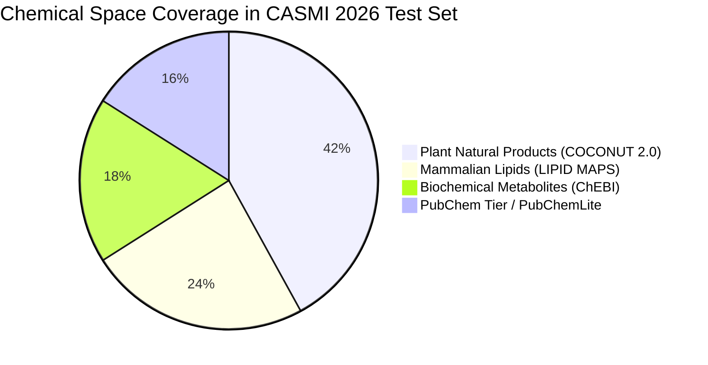

# Candidate Databases and Popularity Priors for CASMI 2026

## 1. Candidate Universe and the Recall Ceiling

In structure elucidation from mass spectrometry, candidate retrieval is the first critical gate. If the true molecular structure is missing from your candidate database, **no ranking algorithm can ever achieve a non-zero score**.

$$\text{Upper Bound on MRR@25} \le \text{Candidate Database Recall}$$

---

## 2. Chemical Database Profiles

### 2.1 COCONUT 2.0 (Collection of Open Natural Products)
- **Scale**: ~400,000 curated natural products from plants, fungi, marine organisms, and bacteria.
- **Strengths**: Contains rich structural diversity of secondary metabolites (terpenoids, alkaloids, flavonoids, polyketides).
- **Limitation**: Missing many primary metabolites, mammalian lipids, bile acids, and synthetic drug analogs. Sole reliance on COCONUT creates an artificial ceiling around **0.395 - 0.400 LB**.

### 2.2 ChEBI (Chemical Entities of Biological Interest)
- **Scale**: ~60,000 biologically focused, manually annotated entities.
- **Strengths**: Extremely high fidelity for endogenous biochemistry (amino acids, cofactors, carbohydrates, nucleotides, vitamins).

### 2.3 LIPID MAPS
- **Scale**: ~45,000 lipid structures classified into 8 categories: Fatty Acyls, Glycerolipids, Glycerophospholipids, Sphingolipids, Sterol Lipids, Prenol Lipids, Saccharolipids, and Polyketides.
- **Why it matters**: Biological extracts from plasma, liver, or cell membranes are heavily lipid-rich. Their fragmentation patterns follow characteristic headgroup losses ($m/z$ 184 for phosphocholine, $m/z$ 141 for phosphoethanolamine).

### 2.4 PubChem Tier & PubChemLite
- **PubChem Scale**: >115 million chemical compounds. Searching uncurated PubChem creates massive decoy explosion (billions of combinatorial isomers that have never existed in nature).
- **PubChemLite**: Curated subset of PubChem filtered by bio-relevance:
  - Compounds with at least one PubMed ID (PMID), patent citation, or bioassay activity.
  - Subsets categorized by annotation tier: Tier 1 (verified natural product/metabolite), Tier 2 (bioactive/drug), Tier 3 (chemical catalog).

---

## 3. Bayesian Literature and Popularity Priors

### 3.1 The Decoy Displacement Problem
When expanding candidate pools with PubChem candidates (`PC_JOIN_N=50`), each mass window acquires dozens of synthetic chemical oddities. A pure fingerprint or spectral similarity model will occasionally assign a high random score to a decoy, pushing the true natural product down from Rank 1 to Rank 6 or out of the top 25 entirely.

### 3.2 Prior Formulation
To penalize decoys while promoting authentic metabolites, we construct a literature-weighted Bayesian log-prior:
$$\text{Prior}(c) = \log\left( 1 + 1.3 \cdot \text{PMID}(c) + 0.8 \cdot \text{SID}(c) \right)$$
where:
- $\text{PMID}(c)$: Number of peer-reviewed scientific publications mentioning the compound in PubMed.
- $\text{SID}(c)$: Number of independent Substance Records submitted to PubChem (reflecting physical availability in chemical repositories).

### 3.3 Prior Blending Hyperparameters
In our fusion engine:
$$S_{\text{final}}(c) = (1 - \mu) \cdot S_{\text{model}}(c) + \mu \cdot \text{Prior}_{\text{norm}}(c)$$
with:
$$\mu = 0.28$$
This optimal balance preserves high ranks for rare natural products while decisively demoting random combinatorial decoys.
