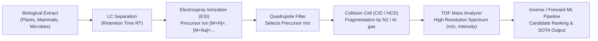

# Chemistry and Mass Spectrometry Foundations for CASMI 2026

## 1. Executive Summary & Physics of Tandem Mass Spectrometry (MS/MS)

In the **Enveda CASMI 2026 - Molecule ID From Mass Spectra** competition, our fundamental task is to deduce the exact 2D chemical structure (represented as a SMILES string and evaluated by its 14-character skeletal InChIKey) of unknown small molecules from their tandem mass spectra ($MS^2$ or $MS/MS$).



### 1.1 Electrospray Ionization (ESI) and Ionization Polarities
In biological extracts (plant natural products, mammalian blood/plasma, microbial cultures), molecules are ionized via Electrospray Ionization (ESI). ESI is a **soft ionization** technique that generates quasi-molecular intact ions without excessive premature decomposition.
- **Positive Mode ($ESI^+$)**: Predominant in basic molecules, amines, alkaloids, and standard peptides. Protons ($H^+$), sodium cations ($Na^+$), ammonium ($NH_4^+$), or potassium ($K^+$) adhere to the molecule.
- **Negative Mode ($ESI^-$)**: Predominant in acidic molecules, carboxylic acids, phenols, sulfonates, and phosphate esters. Deprotonation ($[M-H]^-$) or adduct formation ($[M+HCOO]^-$, $[M+CH_3COO]^-$) occurs.

### 1.2 Collision-Induced Dissociation (CID) and Energetics
Inside the collision cell:
1. The isolated precursor ion is accelerated into a collision gas (typically $N_2$ or Argon) with a kinetic energy determined by the **Collision Energy (CE)** (in electron volts, eV, typically 10 eV to 60 eV, or stepped ramps).
2. Inelastic collisions convert kinetic energy into internal vibrational energy.
3. Vibrational energy redistributes across all molecular bonds (Rice-Ramsperger-Kassel-Marcus / RRKM theory) until the weakest labile bonds dissociate, producing **product ions** (fragments) and **neutral losses**.

---

## 2. Adduct Chemistry & Precursor Mass Calculations

Accurate neutral monoisotopic mass determination requires accounting for the exact mass of the adduct species:

| Adduct Type | Polarity | Ion Mass Formula | Mass Difference from $M$ ($\Delta m$, Da) | Typical Prevalence in CASMI |
| :--- | :---: | :--- | :---: | :---: |
| $[M+H]^+$ | $+$ | $M + 1.007276$ | $+1.007276$ | ~70% |
| $[M+Na]^+$ | $+$ | $M + 22.989218$ | $+22.989218$ | ~15% |
| $[M+NH_4]^+$ | $+$ | $M + 18.033823$ | $+18.033823$ | ~8% |
| $[M-H_2O+H]^+$| $+$ | $M - 17.003290$ | $-17.003290$ | ~5% |
| $[M+K]^+$ | $+$ | $M + 38.963158$ | $+38.963158$ | ~2% |
| $[M-H]^-$ | $-$ | $M - 1.007276$ | $-1.007276$ | ~80% ($ESI^-$) |
| $[M+HCOO]^-$| $-$ | $M + 45.000495$ | $+45.000495$ | ~15% ($ESI^-$) |

### 2.1 The Mass Tolerance Metric (ppm vs Da)
High-resolution mass spectrometers (like Bruker timsTOF used in CASMI 2026) have sub-ppm mass accuracy:
$$\text{Mass Error (ppm)} = \frac{|m/z_{\text{observed}} - m/z_{\text{theoretical}}|}{m/z_{\text{theoretical}}} \times 10^6$$
In our retrieval engines:
- Candidate databases (COCONUT, ChEBI, LIPID MAPS, PubChem Tier) are filtered with a strict precursor mass window:
  $$\Delta m \le \max(0.010\,\text{Da},\, 10\,\text{ppm} \times m/z)$$
This reduces the candidate search space from >150 million molecules down to ~50–2,000 candidate structures per query.

---

## 3. Characteristic Neutral Losses and Diagnostic Fragments

Tandem MS spectra contain two complementary forms of evidence:
1. **Product Ions (Fragments)**: Positively charged substructures retaining the charge.
2. **Neutral Losses**: Neutral uncharged molecules ejected during fragmentation:
   $$\Delta m_{\text{loss}} = m/z_{\text{precursor}} - m/z_{\text{fragment}}$$

### Common Diagnostic Losses:
- **$-18.0106$ Da ($H_2O$)**: Alcohols, phenols, carboxylic acids, sugars.
- **$-27.9949$ Da ($CO$)**: Ketones, aldehydes, flavones, quinones.
- **$-43.9898$ Da ($CO_2$)**: Carboxylic acids, lactones, esters.
- **$-17.0265$ Da ($NH_3$)**: Primary amines, amino acids, alkaloids.
- **$-97.9769$ Da ($H_3PO_4$)**: Phospholipids, phosphorylated metabolites.
- **$-162.0528$ Da ($C_6H_{10}O_5$, Hexose loss)**: Glycosides, flavonoid glycosides.
- **$-132.0423$ Da ($C_5H_8O_4$, Pentose loss)**: Pentosides, nucleosides.

---

## 4. Molecular Identifiers: SMILES, InChI, and InChIKey

### 4.1 Canonical SMILES vs Tautomer Ambiguity
SMILES (Simplified Molecular Input Line Entry System) represents molecular graphs as ASCII strings. However, standard SMILES strings:
- Can vary widely based on atom numbering and aromaticity perception.
- Are sensitive to tautomeric shifts (e.g., keto-enol tautomerism $O=C-CH_2- \leftrightarrow HO-C=CH-$).

### 4.2 InChIKey14: The CASMI Evaluation Target
The competition evaluates **MRR@25 on the first 14 characters of the Tautomer-Canonical InChIKey**:
```
InChIKey = BSYNRYMUTXBXSQ-UHFFFAOYSA-N
           \____________/ \________/ |
              Layer 1      Layer 2   Layer 3
             (14 chars)    (Stereo)  (Charge/Proton)
```
- **Layer 1 (14 characters)**: Hashes the molecular skeleton, connectivity, and atom types, independent of stereochemistry (R/S, cis/trans, axial/equatorial) and tautomeric hydrogen placement.
- **Why this matters for ML**: If a candidate molecule has the correct molecular skeleton but differs by stereocenter or tautomer representation, **it receives 100% credit** if its 14-char InChIKey matches the ground truth.
- **Crucial Rule**: When deduplicating candidate lists, always group by `InChIKey[:14]` to prevent wasting top-25 slots on stereoisomers that share the same 14-character key.
