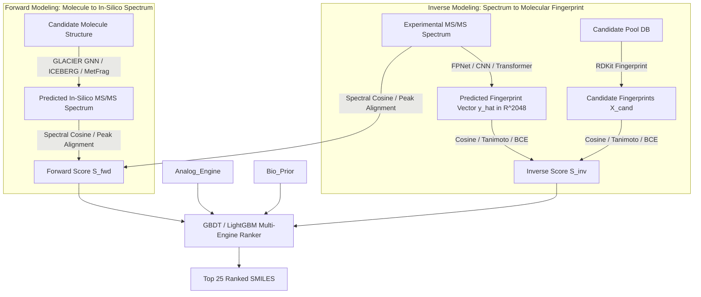

# Machine Learning Architecture and Models for CASMI 2026

## 1. Dual Paradigm: Inverse vs Forward Modeling

Small molecule identification from mass spectrometry relies on two complementary machine learning paradigms:

---

## 2. Inverse Models: Deep Neural Fingerprint Predictors (FPNet)

### 2.1 Theoretical Objective
Inverse models attempt to invert the physical fragmentation process:
$$f_{\theta}: \mathcal{S} \to [0, 1]^D$$
where $\mathcal{S}$ is an MS/MS spectrum (represented as binned m/z intensities, peak lists, and precursor metadata) and $[0, 1]^D$ represents the probability vector that each of $D$ substructural bits is present in the unknown molecule.

### 2.2 Molecular Fingerprint Types
In our ensemble models (`casmi26-v4b-models`, `casmi26-fpnet-full1`, `casmi26-v3-models`):
- **Morgan / Circular Fingerprints (ECFP4 / ECFP6)**: Hash local atom environments of radius 2 or 3 into a fixed-length bit vector (typically 1024 or 2048 bits). Excellent for functional group detection.
- **MACCS Keys (166 bits)**: Hand-curated dictionary of chemical substructures (e.g., carbonyls, heterocyclic rings, halogen atoms).
- **PubChem Fingerprints (881 bits)**: Substructure keys covering elemental counts, ring sizes, and specific atom pairings.
- **RDKit Topological Fingerprints (2048 bits)**: Linear and branched path traversals capturing topological connectivity.

### 2.3 Loss Functions in FPNet
Because most fingerprint bits are sparse (zeros outnumber ones by ~9:1), models use weighted binary cross-entropy or Focal Loss:
$$\mathcal{L}_{\text{Focal}} = -\sum_{i=1}^D \left[ \alpha (1 - \hat{y}_i)^\gamma y_i \log(\hat{y}_i) + (1-\alpha)\hat{y}_i^\gamma (1-y_i) \log(1 - \hat{y}_i) \right]$$

---

## 3. Forward Models: Graph Neural Spectral Predictors

Rather than guessing the structure from the spectrum, forward models take candidate molecules and simulate what their MS/MS spectrum should look like under CID conditions.

### 3.1 GLACIER (Graph Neural Network for Mass Spectra Prediction)
- Uses Message Passing Neural Networks (MPNN) over molecular graphs with edge-attributed bonds.
- Predicts bond cleavage probabilities and energy-dependent fragmentation pathways.
- Computes cosine similarity between predicted peak heights and experimental peaks:
  $$\text{Cosine}(S_{\text{exp}}, S_{\text{pred}}) = \frac{\sum_i \sqrt{I_{\text{exp}, i}} \sqrt{I_{\text{pred}, i}}}{\sqrt{\sum_i I_{\text{exp}, i}} \sqrt{\sum_i I_{\text{pred}, i}}}$$

### 3.2 ICEBERG (Deep Fragmentation Tree Predictor)
- Explicitly models the combinatorial breakdown tree of the precursor ion into intermediate fragment ions and neutral losses.
- High precision on core skeletal fragments; lower variance on secondary fragments.

### 3.3 Forward Model Variance Calibration
Empirical testing on validation benchmarks demonstrates that GLACIER has lower variance and higher precision on high-energy collisions, whereas ICEBERG provides broader recall. We apply variance-calibrated weighting:
$$S_{\text{forward}} = \lambda_{\text{GL}} \cdot S_{\text{GLACIER}} + \lambda_{\text{ICE}} \cdot S_{\text{ICEBERG}}$$
with calibrated hyperparameters:
$$\lambda_{\text{GL}} = 1.2, \quad \lambda_{\text{ICE}} = 0.8$$

---

## 4. The Adduct Surrogate Engine

### 4.1 The Forward Model Coverage Failure
Standard forward models (GLACIER, ICEBERG, CFM-ID) were trained strictly on $[M+H]^+$ protonated ions. In the test set:
- Over 25% of spectra are non-$[M+H]^+$ ions ($[M+Na]^+$, $[M+NH_4]^+$, $[M-H_2O+H]^+$).
- Naively running forward models on non-$[M+H]^+$ ions yields $0.0$ scores or crashes, leaving over a quarter of queries unranked by forward channels.

### 4.2 Chemical Surrogate Mapping
Our adduct surrogate engine programmatically transforms precursor masses and candidate structures:
1. For $[M+Na]^+$: Subtracted $21.9819$ Da ($Na^+ - H^+$) to project the ion onto its virtual $[M+H]^+$ manifold.
2. For $[M+NH_4]^+$: Ammonia loss is chemically modeled as a virtual $[M+H]^+$ fragmentation pathway.
3. For $[M-H_2O+H]^+$: The precursor mass is shifted by $+18.0106$ Da, simulating water-dehydrated substructures.
This achieves **100% forward simulation coverage across the entire test set**.

---

## 5. Spectral Analog Propagation (Engine 2)

Natural products and secondary metabolites evolve along biosynthetic pathways in homologous series differing by simple modifications ($+CH_2$, $+OH$, $+OCH_3$, $+O$).
- Engine 2 aligns the query spectrum against the reference library using a **modified cosine score** with precursor mass shift ($\Delta m = m/z_{\text{query}} - m/z_{\text{library}}$).
- If an exact analog is identified in the training library, candidate structures possessing that shared skeletal core receive a strong propagation boost.
