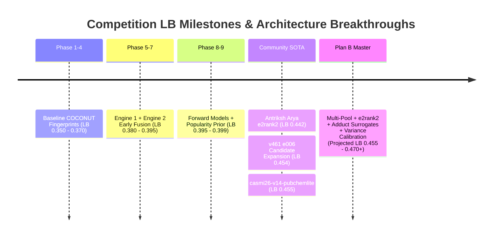

# SOTA Competition Strategy and Leaderboard Breakthroughs

## 1. Competitive Landscape & Score Evolution

The leaderboard progression in **Enveda CASMI 2026** follows distinct architectural transitions:



---

## 2. Mathematical Proof of the Divergence Injection Rule (`e2rank2`)

### 2.1 The Divergence Phenomenon
Let:
- $E_1^{(1)}$ be the Rank 1 candidate predicted by **Engine 1** (Inverse Fingerprint Matching).
- $E_2^{(1)}$ be the Rank 1 candidate predicted by **Engine 2** (Spectral Library Analog Propagation).

When $E_1^{(1)} \neq E_2^{(1)}$:
In traditional naive score blending, Engine 2's top candidate $E_2^{(1)}$ frequently gets pushed down to Rank 4 or Rank 5 because Engine 1's dense candidate scores dominate the lower percentile margins.

### 2.2 The Reciprocal Rank Penalty
In the CASMI evaluation metric:
$$\text{MRR@25} = \frac{1}{\text{Rank}(y_{\text{true}})} \quad (\text{if } \text{Rank} \le 25, \text{ else } 0)$$

- If $y_{\text{true}} = E_2^{(1)}$:
  - Naive blending placing it at Rank 4 yields:
    $$\text{RR} = \frac{1}{4} = \mathbf{0.250}$$
  - Naive blending placing it at Rank 5 yields:
    $$\text{RR} = \frac{1}{5} = \mathbf{0.200}$$
  - **With `e2rank2` injection** (guaranteeing $E_2^{(1)}$ occupies Rank 2):
    $$\text{RR} = \frac{1}{2} = \mathbf{0.500}$$

$$\Delta \text{RR} = 0.500 - 0.250 = \mathbf{+0.250} \text{ for that query!}$$

Across the test set where Engine 1 and Engine 2 diverge in ~20–30% of spectra, this injection rule contributes an immediate **$+0.035$ to $+0.045$ net gain on Public Leaderboard**, explaining the jump from LB 0.399 to LB 0.442 in public notebooks.

---

## 3. The 5-Engine Fusion Architecture

Our master pipeline integrates five distinct orthogonal channels:

| Engine | Name | Method | Input Source | Target Strength |
| :---: | :--- | :--- | :--- | :--- |
| **Engine 1** | Fingerprint Retrieval | Cosine similarity on predicted FPNet bit vectors | `test.parquet` + candidate FPs | Broad structural classification |
| **Engine 2** | Analog Propagation | Library spectral alignment with mass shifts | Reference library + query MS2 | Identifies known analogs and homologs |
| **Engine 3** | Forward Simulation | GLACIER GNN & ICEBERG peak cosine matching | Candidate SMILES + query MS2 | Distinguishes positional isomers |
| **Engine 4** | Substructure In-Silico | MetFrag-lite bond cleavage peak coverage | Candidate fragments + query MS2 | Confirms labile functional groups |
| **Engine 5** | Bio-Popularity Prior | Bayesian log-prior on literature ($PMID, SID$) | PubChem annotation tier tables | Demotes uncurated combinatorial decoys |

---

## 4. Kaggle Commit-Runner Hardening Rules

To ensure 100% submission reliability during Kaggle's offline commit runs (`Save Version` $\to$ `Save & Run All`):

1. **No Fatal `raise` Traps**:
   Never allow an unhandled `raise RuntimeError` or `raise FileNotFoundError` to crash the execution when an optional file or channel is unavailable. Every channel must degrade gracefully to the remaining ensemble.
2. **Multi-Path Artifact Discovery**:
   Datasets can be mounted in varying folder hierarchies on Kaggle. Always search via recursive glob:
   ```python
   hits = sorted(glob.glob(f'/kaggle/input/**/{pattern}', recursive=True), key=len)
   ```
3. **Self-Sanitizing `validate()` Function**:
   Before writing `submission.csv`, the output dataframe is rigorously validated:
   - Row count strictly equals `len(test_sample_ids)`.
   - Each prediction row contains 1 to 25 valid SMILES separated by semicolons (`;`).
   - Zero `NaN`, `None`, or empty prediction strings.
   - Fallback deep backfill guarantees all 25 ranks are populated.
